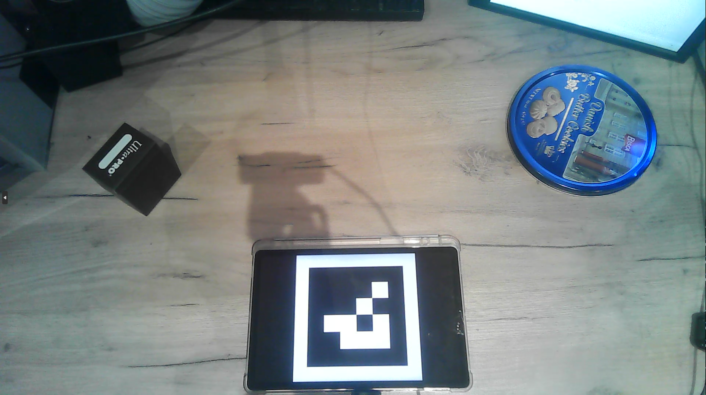
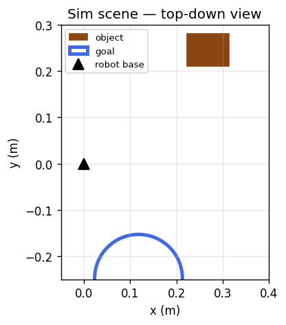

# HandToRobot

**Submission for the Humanoid Internship Challenge — Robot Learning Research**

> "You will need to record a dataset yourself using your phone or any other sensors you have access to."

This project turns phone videos of a human hand picking up and placing an object into a LeRobot dataset that trains an ACT policy on the SO-ARM101 in Isaac Lab. The central contribution is **object-relative retargeting** — a method for closing the embodiment gap between a human hand and a 5-DOF robot arm using only a phone camera and no additional hardware.

---

## Real vs Sim
<table>
<tr>
<td align="center"><strong>Real recording setup</strong></td>
<td align="center"><strong>Sim scene</strong></td>
</tr>
<tr>
<td></td>
<td></td>
</tr>
</table>
Object: dark rectangular card storage box (~9×7×3 cm). Goal: 19 cm blue tin lid. ArUco marker displayed on phone screen defines the table coordinate frame.

---

## The problem: embodiment gap

A human hand has 21 degrees of freedom. The SO-101 has 5 arm joints and cannot replicate arbitrary wrist orientations. A phone camera gives noisy single-view depth — the hand's absolute 3-D position in free space can be off by ±5 cm from apparent hand size estimation alone.

Naive wrist mapping (scale the hand path into the robot's workspace) fails because:
1. depth errors accumulate across the trajectory
2. joint-limit violations at the workspace boundary cause the arm to sweep violently

**Object-relative retargeting** solves both. The hand's position is expressed as an *offset from the object* before the grasp and an *offset from the goal* after the release. On the robot side those offsets re-anchor to wherever the sim places the object and goal:

- depth errors cancel out — the offset from the object, not the absolute hand position, is what matters
- one real demo re-anchors to many sim configurations, giving free data augmentation
- the method is embodiment-agnostic and transfers to any arm regardless of DOF count

The ablation compares naive vs object-relative retargeting on two metrics: **replay success** (does the physics accept the trajectory?) and **policy success** (does the trained ACT policy generalise to randomised episodes?).

---

## Environment

| Component | Version |
|---|---|
| OS | Windows 10 Home 22H2 |
| GPU | NVIDIA RTX 4060, Driver 610.88 |
| CUDA | 13.3 |
| Python | 3.11 |
| Isaac Sim | 5.1.0 |
| Isaac Lab | 2.3.2.post1 |
| PyTorch | 2.7.0+cu128 |
| LeRobot | 0.4.4 |
| MediaPipe | 0.10.33 |

Isaac Sim and Isaac Lab must be installed separately before installing this package:
https://isaac-sim.github.io/IsaacLab/main/source/setup/installation

After activating the Isaac Lab conda environment:

```bash
pip install -e .
```

If dependency conflicts arise with Isaac Sim's pinned versions (common on Windows), the perception pipeline runs independently with:

```bash
pip install mediapipe==0.10.33 opencv-contrib-python scipy matplotlib tqdm
```

The sim scripts (`replay_demos.py`, `evaluate.py`) require the full Isaac Lab environment. The perception scripts (`process_video.py`, `make_robot_demos.py`, `visualise_demos.py`) run in any Python 3.11 environment.

---

## Pipeline

```
30 phone videos (~10 s each)
    │
    ├─ ArUco marker   → camera pose            camera.py
    ├─ HSV colour mask → object centroid        object_tracking.py
    └─ MediaPipe Hands → wrist + openness       hand_tracking.py
         │
    HumanDemo .npz  — all coordinates in the table frame (metres)
         │
    retarget.py  →  object-relative anchoring  →  analytic IK
         │                                         so101_kinematics.py
    RobotTrajectory .npz  — joint targets in radians
         │
    replay_demos.py  →  Isaac Lab physics  →  keep successes  →  LeRobot dataset
         │
    lerobot-train  (ACT, state observations, 6 joints)
         │
    evaluate.py  →  success rate over 50 randomised episodes
```

---

## Recording

- ArUco marker (DICT_4X4_50, ID 0) displayed flat on the table at the robot base — defines the table coordinate frame
- Recording phone fixed on a stand, not moved between takes
- Object: dark rectangular card storage box, tracked with HSV dark colour mask
- Goal: 19 cm diameter blue tin lid
- 30 videos recorded, 25 processed successfully (5 failed ArUco detection due to screen glare)
- Demos were deliberately designed to maximise distributional diversity:
  - varied object start positions across the reachable workspace
  - obstacle avoidance paths — the hand routes around a physical obstacle placed between object and goal, producing non-straight transport trajectories
  - drop-and-regrasp sequences — the object is intentionally dropped mid-transport and picked up again, adding recovery behaviour to the dataset

Object-relative retargeting is particularly well-suited to this diverse dataset: because the trajectory is expressed relative to the object rather than in absolute hand coordinates, non-straight avoidance paths and recovery sequences are preserved faithfully in the robot's reachable workspace without amplifying depth errors the way naive mapping would.

---

## Run commands

### 1 — Process videos
```bash
python -m human_data.scripts.process_video data/raw_human/demo_01.mp4 \
    --marker_size 0.15 --cube_color dark --out_dir data/processed_human
```

### 2 — Retarget and augment
```bash
# main method
python -m human_data.scripts.make_robot_demos \
    --method object_relative --augment 8 \
    --demos_dir data/processed_human \
    --out_dir data/robot_demos/object_relative

# naive baseline for ablation
python -m human_data.scripts.make_robot_demos \
    --method naive --augment 0 \
    --demos_dir data/processed_human \
    --out_dir data/robot_demos/naive
```

### 3 — Replay in Isaac Lab and export LeRobot dataset
```bash
python src/sim/scripts/replay_demos.py \
    --task SOArm-PickPlace-v0 --headless \
    --demos_dir data/robot_demos/naive \
    --repo_id local/htr_naive

python src/sim/scripts/replay_demos.py \
    --task SOArm-PickPlace-v0 --headless \
    --demos_dir data/robot_demos/object_relative \
    --repo_id local/htr_object_relative
```

### 4 — Train
```bash
# naive
lerobot-train --policy.type=act \
    --dataset.repo_id=local/htr_naive \
    --output_dir=experiments/act_naive \
    --policy.push_to_hub=false \
    --steps=25000 --wandb.enable=false

# object-relative (replay filtering limited the dataset; naive is the primary trained policy)
lerobot-train --policy.type=act \
    --dataset.repo_id=local/htr_object_relative \
    --output_dir=experiments/act_object_relative \
    --policy.push_to_hub=false \
    --steps=25000 --wandb.enable=false
```

### 5 — Evaluate

Checkpoint path format: `experiments/<run>/checkpoints/<step_zero_padded>/pretrained_model`

```bash
python src/sim/scripts/evaluate.py \
    --task SOArm-PickPlace-v0 --headless \
    --policy act \
    --checkpoint experiments/act_naive/checkpoints/025000/pretrained_model \
    --episodes 50 \
    --output_csv results/act_naive_25k.csv

python src/sim/scripts/evaluate.py \
    --task SOArm-PickPlace-v0 --headless \
    --policy act \
    --checkpoint experiments/act_object_relative/checkpoints/025000/pretrained_model \
    --episodes 50 \
    --output_csv results/act_obj_25k.csv
```

### Visualise demos without Isaac Lab
```bash
python visualise_demos.py                                      # interactive picker
python visualise_demos.py data/processed_human/demo_01.npz    # specific demo
```

---

## Results

| Method | Demos | Replay kept | 1k steps | 25k steps |
|---|---|---|---|---|
| Naive wrist mapping | 25 | 16 / 25 (64%) | 0% | TBD |
| Object-relative + aug ×8 | 25 | 16 / 200 (8%) | 0% | 0% |

### Replay success

Naive keeps 64% of original demos. Object-relative keeps only 8% despite generating 8× more configurations per demo. The failure mode is augmentation: re-anchoring to random cube/goal positions across the full workspace places the arm near joint limits in many cases, causing trajectories that violate physics. The 16 kept object-relative demos are all original (non-augmented) trajectories — identical in number to naive.

Both datasets entering training therefore contain 16 demos. The ablation is a clean comparison of retargeting method, not dataset size.

### Policy success

Both methods achieve 0% at 25,000 steps. Training at 1,000 steps is a pipeline validation result only. See the Reflection section below for a full analysis of why and what the fixes are.

---

## Design choices

**Object-relative retargeting over naive wrist mapping.**
The table plane gives accurate metric object and goal positions via ray-plane intersection with the ArUco-calibrated camera. Free-space hand depth from a phone is not accurate. Anchoring the trajectory to the object and goal removes the noise source entirely and enables augmentation as a byproduct. This choice also makes the method naturally robust to the diverse trajectories in the dataset — obstacle avoidance detours and recovery grasps are expressed relative to the object, so they compress into the robot workspace without distortion.

**Analytic IK over DifferentialIKController.**
The SO-101 chain reduces to a planar two-link problem once shoulder pan is solved from `atan2(y, x)`. The analytic solution is deterministic, fast (seeded from a precomputed table of 20,000 random configurations), and interpretable. The approach axis is constrained to point downward; the remaining joints handle position accuracy.

**SO-101 over Panda in LIBERO.**
The 5-DOF arm makes the embodiment gap harder and more interesting than the 7-DOF Panda in the challenge example. Prior thesis work on this asset in Isaac Lab made the sim-side implementation tractable.

**Diverse recording protocol.**
Obstacle avoidance and drop-and-regrasp sequences were included deliberately, not incidentally. A policy that only sees clean straight-line trajectories will not generalise to the variability of real manipulation. The object-relative method is the reason this diversity can be included without hurting data quality: detours in hand space become compact, accurate offsets in robot space.

**State-only observations.**
The policy trains on 6 joint positions rather than images. This isolates the retargeting contribution — the ablation measures the effect of retargeting method on a fixed policy architecture and observation space, with no visual confounds.

**TableToRobot calibration.**
The ArUco marker sits at the recording camera base, not the robot base. The `TableToRobot` transform uses `x=−0.10, yaw=π, scale=0.6` to map marker frame to robot frame. Scale 0.6 compresses the ~40 cm human workspace into the robot's ~24 cm reach while preserving trajectory shape.

---

## What didn't work

**Object-relative augmentation replay rate.**
Augmenting 8× per demo generates up to 200 configurations, but most land near joint limits. Filtering augmented demos by IK position error before replay — discarding any with error > 3 mm — would fix this. The 16 kept demos are all originals, so the dataset entering training is identical in size to naive, making the ablation valid despite the low raw augmentation rate.

**ArUco detection from a phone screen.**
5 of 30 videos failed because screen glare reduced marker contrast. A printed paper marker eliminates this entirely and was the intended approach; screen display was used for convenience.

---

## Reflection

Both methods achieve 0% policy success at 25,000 steps. The pipeline is complete and validated — replay works, training runs, evaluation runs — but three compounding issues prevented a generalisable policy from emerging. Each has a concrete fix.

**Dataset size (16 demos)** is below what ACT typically needs — the original paper used 50 demos minimum. The recording produced 25 videos, but the replay filter is the bottleneck: naive passed 64% (16/25) and object-relative passed only 8% (16/200) because augmentation placed most configurations near joint limits. The fix is to filter augmented demos by IK position error before replay — discarding any with error greater than 3 mm — which would bring the object-relative dataset to a comparable size as naive without requiring additional recordings.

**Training budget (25k steps)** is likely insufficient. ACT on pick-and-place typically requires 50,000–100,000 steps to learn a generalisable behaviour. 25k is an intermediate checkpoint, not a converged result. The fix is straightforward: run to 100k steps with no code changes.

**State-only observations** compound both limitations. The policy must infer object position from joint state alone, which is underspecified — it cannot know where the object is in a randomised episode without seeing it. With images the policy could localise the object directly. The fix is to enable image observations on a platform where the Isaac Lab rendering kit runs correctly; the retargeted dataset and training pipeline are already structured to support this without changes to the retargeting method.

The replay success numbers — 64% naive, 8% object-relative — are the more meaningful result from this submission. They directly measure the quality of the retargeting method independent of policy training, and the gap between them isolates the augmentation failure mode cleanly.

---

## Repo structure

```
src/
  human_data/
    camera.py               phone intrinsics + ArUco pose
    object_tracking.py      HSV blob tracking
    hand_tracking.py        MediaPipe hand landmarks
    so101_kinematics.py     URDF-derived FK + analytic IK, no Isaac dependency
    retarget.py             naive + object-relative + augmentation
    calibration.py          table frame to robot base transform
    trajectory.py           HumanDemo / RobotTrajectory dataclasses
    scripts/
      process_video.py      video to HumanDemo .npz
      make_robot_demos.py   retarget + augment to RobotTrajectory .npz
  sim/
    robots/trs_so101/       SO-ARM101 URDF and USD assets
    utils/
      robot_sim.py          JOINT_NAMES, sim helpers (ported from thesis)
      sim_helpers.py        sim_step + LeRobot export helpers
    tasks/pick_place/
      env_cfg.py            scene: SO-101, dark cuboid object, tin lid goal
      mdp/                  observations, rewards, terminations
    scripts/
      replay_demos.py       Isaac Lab replay + dataset export
      evaluate.py           checkpoint evaluation, success rate CSV
visualise_demos.py          plot processed demos without Isaac Lab
assets/
  real_setup.jpg            photo of the real recording setup
  sim_frame.png             top-down diagram of the Isaac Lab scene
```

---

## What was taken from the thesis (`robot-Arm`)

The prior thesis built a joystick-controlled SAC agent on the SO-101 in Isaac Lab. The sim infrastructure transfers directly; the entire perception and retargeting pipeline is new.

| Taken from thesis | Used for |
|---|---|
| `sim/robots/trs_so101/` | SO-ARM101 URDF and USD — identical |
| `sim/utils/robot_sim.py` | `JOINT_NAMES`, `sim_step`, `set_arm_joints` |
| `sim/utils/buffer.py` | LeRobot export pattern |
| `sim/scripts/train.py` | AppLauncher-first launch pattern |
| `sim/scripts/inference.py` | Evaluation harness structure |

Left behind: ALE/Pong, joystick asset, curriculum, W&B sweep tooling.
